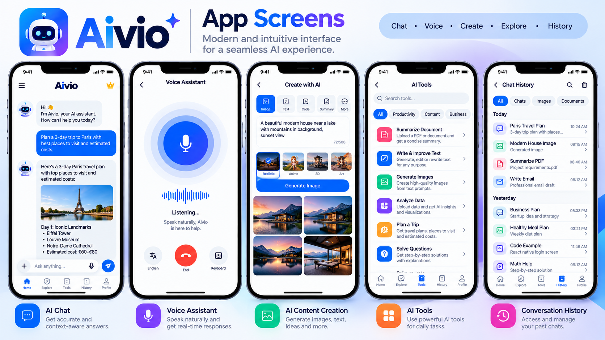
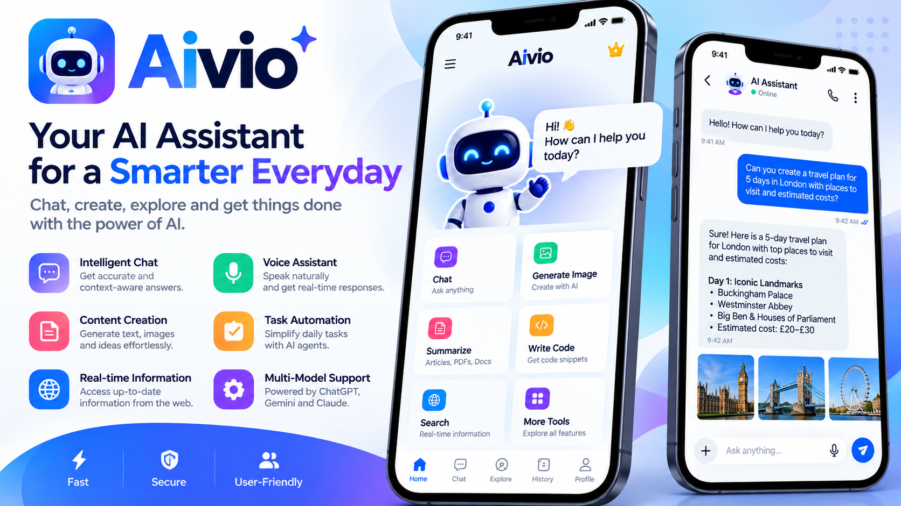

# AIVIO: AI Assistant App (Flutter)

**Our own AI assistant app that combines ChatGPT, Gemini and Claude in one place: chat, AI agents, voice, image generation and document processing.**

Built by [Oriental Tech Solutions](https://github.com/OrientalTechSolutions) · Flutter · iOS & Android

---

## Screenshots

## Why we built it

We wanted one app for chat, voice, images and documents, instead of jumping between AI tools, with agents that can get tasks done.

## Features

- **AI chat** with ChatGPT, Gemini and Claude
- **AI agents** that understand a request and choose the right tool to finish the task
- **Voice conversation:** speech-to-text and text-to-speech
- **AI image generation** from text prompts
- **Document processing:** upload a PDF or document and get summaries and answers
- **AI tools library:** write and improve text, summarize, analyze, plan
- **Chat history** across chats, images and documents

## How a request flows

1. **Request:** type it, say it, or upload a document
2. **AI agent:** understands the request and chooses the right tool
3. **AI models:** ChatGPT, Gemini, Claude, image and voice models
4. **Result:** an answer, a generated image or a spoken reply

## Tech stack

`Flutter` `Dart` `OpenAI API` `Gemini API` `Claude API` `Speech-to-text` `Text-to-speech` `Firebase`

---

> AIVIO is our own product. The code is not public; this repository shows its features and how it works.

**Want AI features like these in your app?** [Hire us on Upwork](https://www.upwork.com/freelancers/attaullahhazarvi)
